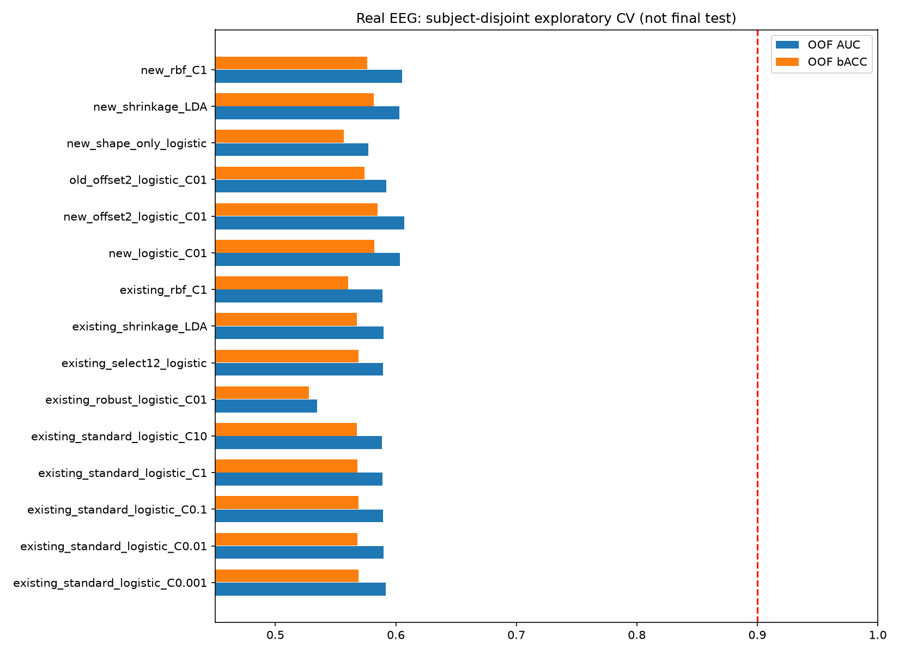
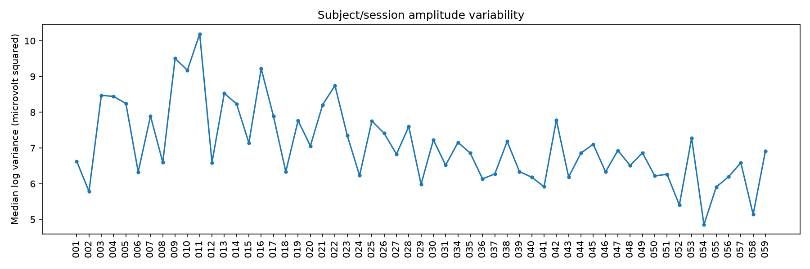
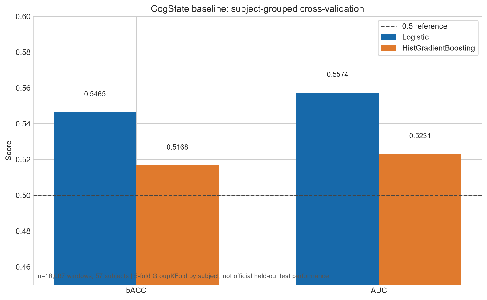
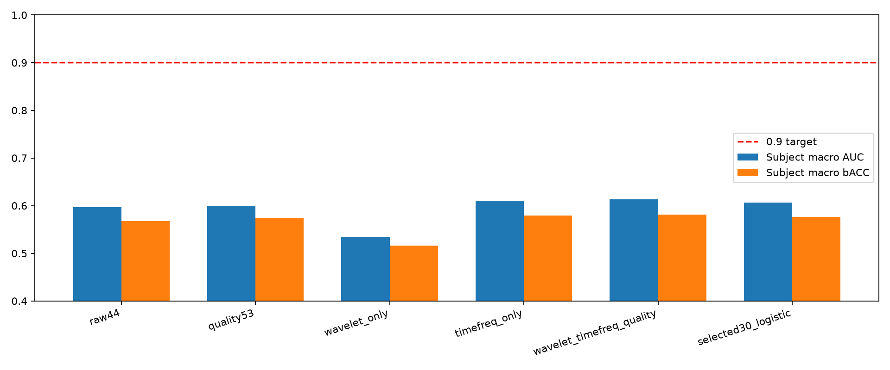
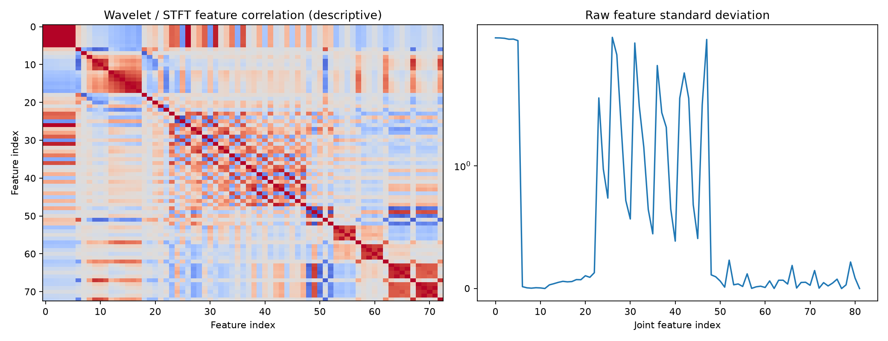
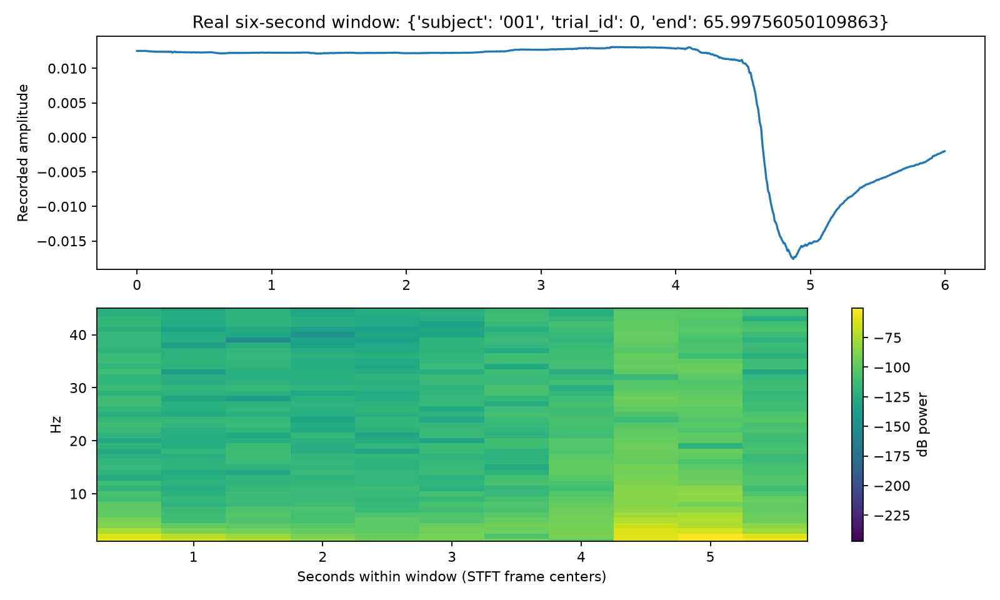
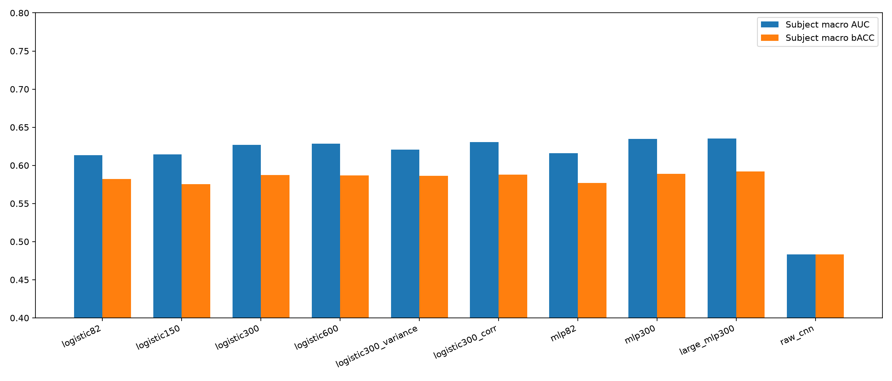
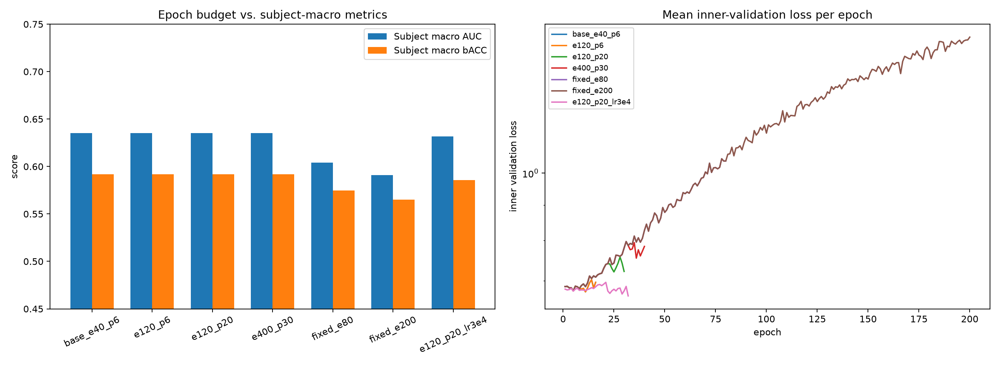
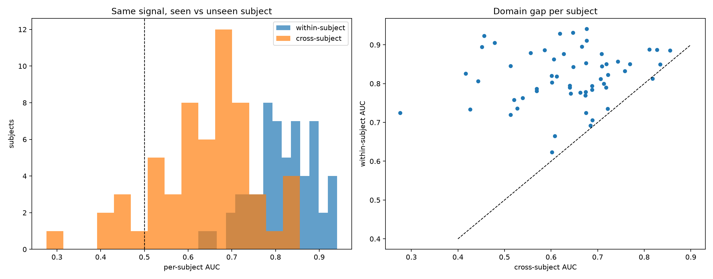
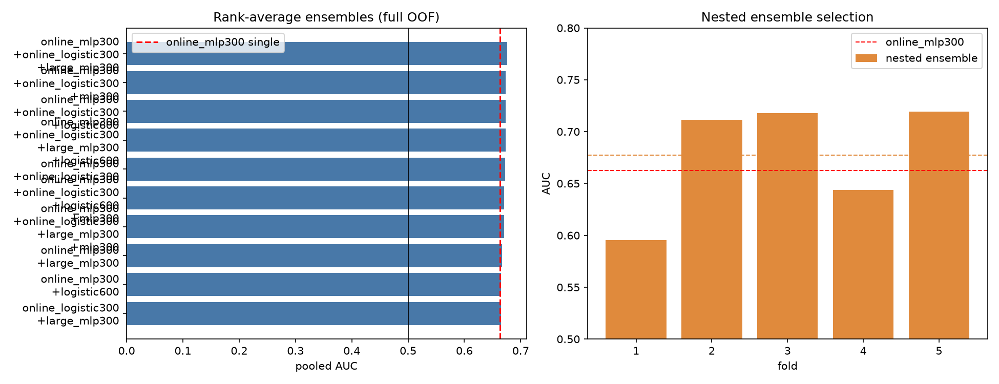

# CogState 基线

## 任务理解与约束

EEG 是脑电电位随时间的记录；BDF+C 是 BioSemi 常见的 24-bit EDF 变体，文件中包含连续采样信号与标注。MNE 的 `read_raw_bdf` 可读取 BDF（参考：<https://mne.tools/1.7/generated/mne.io.read_raw_bdf.html>；格式说明：<https://mne.tools/1.11/auto_tutorials/io/20_reading_eeg_data.html>）。

本赛题是单通道、250 Hz BDF+C 与事件 CSV 的二分类：relax=0、task=1。BDF 文件名提供首样本北京时间（含毫秒），CSV 使用带时区的 `local_time`；用二者的绝对时间差映射样本索引，而不是假定阶段长度。只配对每个 `trial_start` 与其后 `trial_end`，阶段外样本无标签；跳过所有与 `BAD_ACQ_SKIP` 重叠的窗口。

关键约束：每次判断使用的窗口和有效感受野不超过 6 s；判断时刻只能使用当前及过去；滤波不能双向、不能全记录归一化、不能跨窗口平滑，也不能使用测试标签。文档中存在需向主办方确认的冲突：赛题要求写 11 月 5 日提交，操作细则写 11 月 8 日 20:00；赛题正文写选择 8 队晋级，细则写 10 队。本文不擅自裁定。

## AI分析与方法

实现采用严格因果的单向 SOS `sosfilt`（1--45 Hz Butterworth），并拒绝非法 phase、未配对 trial、越界或坏段重叠窗口。每个最新 6 秒窗口计算 44 个特征：对数/相对频带功率、功率比、谱熵/谱重心、RMS/峰峰值/差分能量/高频比例，以及三个时间分段的动态统计。特征不使用全记录归一化或未来样本。训练比较：

1. `StandardScaler + LogisticRegression(class_weight=balanced)`：低方差、可解释，适合作为稳健基线。
2. `HistGradientBoostingClassifier`：可表达非线性频带组合，作为轻量非线性对照。

采用 GroupKFold(n_splits=5)，subject ID 作为 group；所有预处理参数只在训练折拟合，不使用测试折标签调参。这里的 AUC/bACC 是开发集的受试者分组交叉验证估计，不是主办方保留测试集成绩，也不代表理论极限。理论上，若类条件分布完全重叠，任何分类器的 AUC 都只能接近 0.5；若分布可分且观测无噪声，Bayes 最优分类器才可能达到 1，但实际极限需要未知的真实分布，不能由本数据一次实验声称证明。

## 运行

```powershell
python -m pip install numpy scipy pandas scikit-learn mne matplotlib joblib
python src/train.py
python test/plot_results.py
python test/test_causal.py
```

训练脚本按受试者打印进度，输出模型与结果到 `test/`。图表由 `test/plot_results.py` 从 `test/results.json` 读取真实结果生成，不包含折级指标（结果文件未保存折级指标）。

### 流式最小示例

下面示例加载已保存的 Logistic bundle，分块输入 6 秒（250 Hz）的单通道样本；不足 6 秒时返回 `None`，达到窗口后返回 task 概率。将示例保存为临时脚本或在项目根目录交互执行：

```python
import sys
import numpy as np
sys.path.insert(0, "src")
from cogstate import StreamingInference, load_bundle

bundle = load_bundle("test/logistic.joblib")
stream = StreamingInference(bundle["model"], sfreq=bundle["fs"], window=bundle["window"])
probability = None
for chunk in np.array_split(np.zeros(1500), 5):
    probability = stream.update(chunk)
print(f"task_probability={probability:.6f}")
```

对应真实输出（使用 1500 个全零样本、当前已保存模型）为 `task_probability=0.579250`；实际使用时请按时间顺序替换为采集到的单通道样本。概率越高表示 task。

## 实际结果

本机使用 57 份记录、16,067 个 6 秒窗口、44 个因果特征，优先使用 StratifiedGroupKFold 五折（subject 完全隔离）：

|模型|窗口级 bACC|窗口级 AUC|subject 平均 bACC|subject 平均 AUC|
|---|---:|---:|---:|---:|
|Logistic|0.5680|0.5886|0.5677|0.5968|
|校准 LinearSVC|0.5694|0.5866|0.5695|0.5976|
|HistGradientBoosting|0.5401|0.5566|0.5412|0.5576|

结果真实运行生成于 `test/results.json`，其中包含每折 subject 列表、折级指标和 subject/trial 汇总指标；没有使用官方保留测试集。正式训练/推理仍以 `src/train.py` 生成并保存的 Logistic bundle 为准；优化实验没有替换 `test/logistic.joblib` 或正式推理路径。

### 真实优化实验与核查

`test/optimize_real.py` 基于现有 `test/features.npz`，重新读取 57 份真实记录核查事件时间映射、坏段、窗口和特征缓存，并用 `StratifiedGroupKFold(n_splits=5, shuffle=True, random_state=0)` 做 subject-disjoint 探索。缓存核查结果为 16,067×44，labels/groups/features 均与重新提取结果一致。候选包括正则化 Logistic、RobustScaler、特征选择、LDA、RBF，以及 6 秒窗口偏移 2 秒的轻量特征方案。

最佳探索候选为 `new_offset2_logistic_C01`：AUC=`0.606779`（约 `0.6068`），bACC=`0.584658`（约 `0.5847`），样本数 16,004；这是在同一组交叉验证上进行候选比较得到的开发集估计，不是官方保留测试集成绩。重复使用这组 CV 做模型选择会使结果偏乐观，因此不能把 0.6068/0.5847 当作无偏泛化性能。

核查还显示受试者间振幅差异明显（subject median log-variance 的标准差约 1.0903），而单个受试者内部 task/relax 振幅差异的中位绝对值约 0.5872；这提示模型可能利用 subject/session 振幅差异。当前每个 subject 只有一份记录，无法将 subject effect 与 session effect 分离。对未见 subject 使用其全记录统计量做归一化也会引入未来/测试数据，因此没有把该方案作为正式目标方案。

因此，现有真实实验没有证据表明在“未见受试者、严格因果、最多 6 秒”的约束下能够达到 AUC 或 bACC 0.9；0.9 不是由当前数据和实验推导出的可达结论。正式模型尚未替换，当前已保存的 `test/logistic.joblib` 仍来自 `src/train.py` 的正式训练流程。

实验图表：





复现实验与测试命令：

```powershell
python test/optimize_real.py
python test/test_causal.py
python src/train.py
python test/plot_results.py
```

### 结果可视化



图中包含 bACC/AUC 的 0.5 参考线。这里的指标是开发集的受试者分组五折交叉验证估计，不是官方保留测试集成绩；没有折级结果写入 `results.json`，因此未添加折散点。

##### 测试与局限

`test/test_causal.py` 已验证同一窗口特征重复计算一致，以及不同分块到达方式的流式概率一致。当前基线未做在线自适应、伪迹检测或更丰富时频模型，且单通道频谱特征区分度有限；正式提交前应在不触碰保留测试集的前提下继续优化并确认截止日期/晋级名额冲突。

### 单通道严格因果预处理与伪迹消融

新增 `src/preprocessing.py`，默认采用因果 4 阶 Butterworth SOS 1--45 Hz，并按配置使用因果 50/60 Hz IIR 陷波；不使用 `filtfilt`、未来样本、全记录统计或标签。每个窗口提供 amplitude_max、peak_to_peak、RMS、flat_fraction、diff_energy、spike_fraction、low_freq_drift、high_freq_ratio、nan_fraction 质量指标。窗口策略支持 `keep`（原窗）、`features`（追加质量特征）和 `reject`（剔除明显坏窗）；质量分位数阈值只由训练折拟合，再应用验证折。单通道不做 ICA/ASR。

BIOT 重采样已明确拆为：完整离线窗口使用抗混叠 `resample_poly`，严格在线使用显式历史/固定延迟接口；现有 BIOT FFT/resample 实验仍仅是离线完整窗口，不能声称满足实时因果。

使用 `python test/artifact_ablation.py` 在真实 57 subject、16,067 窗口上运行 `StratifiedGroupKFold(5)`，结果写入 `test/artifact_ablation_results.json` 和 `test/artifact_ablation_results.png`，不覆盖正式 `test/logistic.joblib` 或既有结果。实际 OOF：原始 44 维 AUC/bACC=`0.588562/0.567966`；预处理 44 维=`0.580634/0.564832`；增强质量特征 53 维=`0.593261/0.575114`；质量剔除=`0.586284/0.566944`，保留 14,612/16,067（90.95%，剔除 9.05%）。增强质量特征有小幅收益，单独滤波和剔除未超过原始基线；无折出现缺类，所有结果均可评分。具体每折保留数、剔除率与 subject 宏指标见 JSON。该实验是同一 CV 上的消融比较，不能当作无偏最终泛化估计。

测试：`python test/test_preprocessing.py`（因果前缀/分块一致、窗口外不影响、NaN/坏段、固定阈值、polyphase 形状与抗混叠）已通过。正式模型和推理路径保持不变。

### 卡尔曼 + 深度学习实验

`src/kalman_deep.py` 与 `test/train_kalman_deep.py` 已完成真实重跑。当前定义为：`no_kalman=causal_features(raw)`，`kalman=causal_features(Kalman(raw))`，Q=1e-10、R=1e-8、P0=1e-8（均为 V²，Q 为每时间步过程方差），窗口内 reset、单向递推；实际训练 device 为 NVIDIA GeForce GTX 1660 SUPER CUDA。57 名受试者、16,067 个 6 秒窗口使用 subject-disjoint 五折，固定 24 epochs/full-batch（每折仅 24 optimizer steps）；raw CNN 输入为窗口内 6 点块平均到 250 点，未做幅值规范化。最新 OOF 指标为：no_kalman MLP bACC/AUC=0.552594/0.576365，kalman MLP=0.541790/0.563675，raw CNN=0.501161/0.496074，raw+Kalman CNN=0.499004/0.497447。推荐候选为 no_kalman MLP；CNN 结果接近随机，不能声称充分检验 DL 潜力。真实 OOF、正确 fold ID、逐 subject 指标、checkpoint、曲线和图表保存到 `test/kalman_deep_*`；另有正式回归测试 `test/test_kalman_deep.py`。旧错误 `test/kalman_deep_final.pt` 已弃用，不可作为可用 checkpoint；只使用四个新命名 checkpoint。详细结构、参数、测试和指标见 `卡尔曼深度学习实验报告.md`。现有传统模型不替换。

### BIOT 官方预训练迁移实验

已在真实数据上运行 `test/transfer_pretrained.py`：57 个 subject、16,067 个 6 秒窗口，使用 `StratifiedGroupKFold(5, shuffle=True, random_state=0)` 且 subject 完全隔离。原始单通道约 250 Hz 波形通过 `scipy.signal.resample` 重采样为 200 Hz、每窗 1,200 点，再复制为 16 个相同通道，仅用于匹配 BIOT 的 16-channel 输入接口，不代表获得了真实空间通道信息。实验未修改 `EEG_dataset` 原始附件。

官方 checkpoint 下载自 [ycq091044/BIOT](https://github.com/ycq091044/BIOT) 的 `EEG-PREST-16-channels.ckpt`：
`https://raw.githubusercontent.com/ycq091044/BIOT/main/pretrained-models/EEG-PREST-16-channels.ckpt`。文件保存在 `test/pretrained_cache/EEG-PREST-16-channels.ckpt`，大小 13,791,969 bytes，SHA256 为 `40f55f5d23e83796495616c8145c8336fcff2b901c42e8ba5115223081c2ad70`；仓库许可证为 MIT。运行环境为 Python 3.11.9、PyTorch 2.5.1+cu121、MNE 1.13.2、CUDA。

| 模型 | 总参数量 | 可训练参数量 | OOF AUC | OOF bACC |
|---|---:|---:|---:|---:|
| BIOT 冻结 backbone + 分类头 | 3,186,449 | 257 | 0.499195 | 0.491508 |
| BIOT 全量微调 | 3,186,449 | 3,186,433 | 0.491418 | 0.488255 |
| 随机同构冻结 backbone + 分类头 | 3,186,449 | 257 | 0.499015 | 0.496448 |
| 随机同构全量微调 | 3,186,449 | 3,186,433 | 0.485803 | 0.494699 |

结果、四个 OOF 文件和比较图分别保存在 `test/pretrained_transfer_results.json`、`test/pretrained_transfer_oof_*.npz` 和 `test/pretrained_transfer_comparison.png`。复现命令：

```powershell
python test/transfer_pretrained.py
```

BIOT 使用 `center=False` 的 STFT，未读取 6 秒窗口以外的样本；但其线性注意力对完整 6 秒窗口内 token 做双向全局建模。因此上述结果仅是完整 6 秒窗口的离线迁移实验，不能作为严格在线因果模型或提交方案。结果接近随机，BIOT 在本数据协议下没有超过随机同构对照；不能据此宣称 AUC/bACC 达到 0.9。由于 BIOT checkpoint 已成功下载并加载，无需继续尝试 EEGPT/LaBraM；本轮无失败候选模型。

### 非平稳 DWT / STFT 真实消融（2026-10-28）

新增 `test/nonstationary_ablation.py` 和 `test/test_nonstationary.py`。PyWavelets 已安装，无需重复安装。重新读取全部 57 名受试者、16,067 个严格 6 秒窗口，步长 6 秒，按事件与坏段过滤；采用 `StratifiedGroupKFold(5, shuffle=True, random_state=0)`。VarianceThreshold、StandardScaler、可选 ANOVA SelectKBest(k=30) 均只在训练折拟合；固定 balanced LogisticRegression(C=1, max_iter=2000)，概率阈值 0.5。

- DWT：db4、level=5，A5/D5/D4/D3/D2/D1 的对数总能量、相对能量、归一化系数能量熵，以及相邻尺度对数能量比，共 23 维。`mode='zero'` 为窗口两端合成零延拓，保留边界系数，因此存在边界偏差；不读取真实未来样本。尺度不是精确 EEG 频带。
- STFT：1 秒 Hann、0.5 秒步长、11 帧，`boundary=None,padded=False`；五频带对数功率/相对功率的均值、标准差、线性时间趋势、最大值和最小值，共 50 维。新分支先做窗口重置的单向 1–45Hz 四阶 SOS 和 50Hz/Q30 陷波。
- 所有统计只在窗口末端输出，不能将整窗特征回填到窗口内部时刻，不能声称 DWT/STFT 内部每个系数是逐采样零延迟。没有跨窗口状态、未来补样或全记录归一化。
- 单通道没有二维/空间极化或多通道协方差信息，本次不伪造“极化域”。未添加 Hilbert 分支；原44维已含谱熵和频谱重心。
- 53维对照保留既有 `causal_features(causal_filter(raw))+quality` 定义，即包含二次带通；新分支只滤波一次。此次统一加入训练折方差过滤并使用 float64 拼接，基线数值与旧结果有微小数值差异，不覆盖旧记录。

|方案|输入维数|OOF AUC|OOF bACC|subject宏 AUC|subject宏 bACC|
|---|---:|---:|---:|---:|---:|
|原44维|44|0.588743|0.567966|0.596994|0.567731|
|质量53维|53|0.593440|0.575488|0.598578|0.574308|
|wavelet-only|23|0.523027|0.516386|0.534950|0.516521|
|timefreq-only|50|0.602506|0.579846|0.610745|0.579099|
|wavelet+timefreq+quality|82|**0.607749**|**0.582829**|**0.613494**|**0.581720**|
|联合特征选30维 Logistic|82→30|0.598701|0.576693|0.606379|0.575954|

本轮最佳为 82 维联合特征，OOF AUC 比原44维高 0.019006，比质量53维高 0.014310；bACC 分别高 0.014862/0.007341。STFT有小幅收益，单独小波反而较差，筛选30维未优于全部联合特征。**没有达到 AUC 或 bACC 0.9**；这是同一开发集 CV 上的探索性比较，未做独立测试或显著性检验，不能宣称稳定泛化提升。正式模型未替换。

总耗时 230.60 秒（重新提取 221.45 秒）。最佳方案五折建模及指标计算约 1.98 秒，具体各方案和逐折时间以 JSON 为准。结果包含每折指标、受试者列表、逐 subject 指标、宏平均、维数、特征名称和选择索引；另保存 OOF 概率供复核。

```powershell
python -m unittest discover -s test -p test_nonstationary.py -v
python -u test/nonstationary_ablation.py
```

六项新测试通过；完整 unittest discovery 同时通过现有因果/预处理导入检查。脚本检测到同名结果时会拒绝覆盖，重跑应先自行归档本轮 `nonstationary_*` 输出。产物：`test/nonstationary_results.json`、`test/nonstationary_oof.npz`，以及以下三图（诊断统计不用于特征选择）：





### 高维特征与较大网络真实实验（2026-10-28）

`test/highdim_deep_ablation.py` 重新读取57名subject的16,067个非重叠6秒窗口，构建总计858维候选池（包含原82维，另新增776维）：0.5/1/2秒STFT，对数/相对频带功率的mean/std/skew/kurtosis/trend、五分位点、极值和绝对值归一化熵；db4/sym5/coif2五层DWT系数统计；五频带Hilbert包络与瞬时频率；Hjorth、样本熵、排列熵、零交叉和五种滞后自相关。0.5秒对应125点，重叠62点（最接近50%的整数实现）；DWT合成零延拓，Hilbert仅使用当前整窗。瞬时频率受边界和低包络影响，非精确频带真值。单通道空间极化不适用，不构造伪极化域。

外层固定subject-disjoint StratifiedGroupKFold(5,shuffle=True,random_state=0)。方差阈值1e-20、可选贪心绝对相关阈值0.98、SelectKBest(f_classif)、StandardScaler只在训练分区拟合。82维保留原顺序；150/300/600从858维池选择；variance对照为方差过滤后按原顺序截取前300维，并非按方差大小排序。深度网络在外层训练折内再取subject-disjoint四折的第一折作早停验证，选择器/Scaler仅拟合内部训练集，不回到完整外层训练集重训；Logistic使用全部外层训练集，因此二者训练样本量不同。

深度模型采用CUDA、batch128、最多40 epoch、patience6、AdamW(lr=.001,weight_decay=.01)、dropout=.2；权重BCE训练、内部验证未加权交叉熵早停、固定0.5阈值。小MLP为输入→32→16→1，大MLP为300→128→64→1；CNN直接输入1500点原窗，仅使用内部训练集的全局均值/std规范化，三层卷积32/64/64加池化和64维分类头。参数量由sum(numel)计算，Logistic为系数+截距。表中是分类器/网络可训练参数量，不含Scaler统计量、特征选择索引或固定信号处理配置；Logistic82的83=82个权重+1个截距，输入为82维（23维DWT+50维STFT+9维质量），不是83维特征，也不是858维总池。大MLP输入为从858维池按内部训练数据选择的300维，实际顺序为Linear(300,128)→ReLU→Dropout(0.2)→Linear(128,64)→ReLU→Linear(64,1)，预测时使用sigmoid；参数量=(300×128+128)+(128×64+64)+(64+1)=46,849。

大MLP五折实际epochs_run依次为11/16/11/8/11，恢复的best_epoch为5/10/5/2/5；40只是上限，并非每折训练40轮。内部验证损失须比最佳值降低超过1e-5才计为改善，连续6轮未改善即停止并恢复最佳权重。按代码调用边界核对，特征提取仅接收当前1500点，滤波每窗重置；先全量计算这些固定、无学习的窗内特征不等于跨折拟合。未发现外部测试数据参与选择器/Scaler拟合或early stop，但重复查看外层CV选择候选仍有模型选择乐观偏差。

|候选|参数量|OOF AUC|OOF bACC|subject宏 AUC|subject宏 bACC|
|---|---:|---:|---:|---:|---:|
|Logistic82|83|0.607648|0.583264|0.613423|0.582148|
|Logistic150 KBest|151|0.607277|0.576521|0.614271|0.575587|
|Logistic300 KBest|301|0.621663|0.589178|0.626907|0.587389|
|Logistic600 KBest|601|0.621532|0.587095|0.628587|0.587059|
|Logistic300 variance|301|0.616131|0.588048|0.620843|0.586374|
|Logistic300 corr+KBest|301|0.624169|0.588934|0.630527|0.587919|
|MLP82|3,201|0.607842|0.578226|0.615755|0.576990|
|MLP300|10,177|0.623904|0.589683|0.634818|0.588847|
|大MLP300|46,849|0.628321|0.593158|0.635023|0.591835|
|原始窗CNN|80,641|0.477673|0.483031|0.483223|0.482985|

大MLP本轮略优于小MLP，但subject宏AUC只增加0.000205；CNN明显更差且接近随机，不能解释为参数越多越好。600维未在OOF指标上超过300维。所有结果都远未达到0.9；仍是重复使用开发集的探索性候选比较，没有独立测试、重复随机种子或显著性检验。subject与session仍混杂。Hjorth activity在标准化后近似常数，会在选择分支中被过滤；样本熵使用窗内每5点抽取、m=2/r=.2及计数+1稳定化，非全采样精确样本熵。STFT、Hilbert和CNN仅在窗口末端输出，不可回填窗口内较早时刻；是否接受整窗内部双向运算应确认赛方接口要求。

本轮探索性最终候选为大MLP300（不是已部署模型），轻量备选为Logistic300 corr+KBest；正式`test/logistic.joblib`仍未替换。大MLP的领先不能视作已证明的泛化优势。

实际耗时996.95秒，其中提取821.32秒。最终质量核对未重新训练，重新执行下列unittest命令，12项全部通过（高维6项+非平稳6项，0.842秒），另有因果前缀/分块和预处理质量/重采样导入检查PASS。注意这12项计数不包含非unittest形式的独立脚本检查，不代表所有其他实验脚本均重新验证。命令（第二条为历史训练复现入口，本次未执行）：

```powershell
python -m unittest discover -s test -p "test_*.py" -v
python -u test/highdim_deep_ablation.py
```

输出为`test/highdim_deep_results.json`、`test/highdim_deep_oof.npz`、`test/highdim_deep_features.npz`、`test/highdim_deep_comparison.png`及50个`test/highdim_*_fold*.pt`。JSON含每折指标、内部训练/验证及外部测试subject、选择索引、真实参数量、训练曲线、运行时间和窗口元数据；OOF折归属可用JSON测试subject映射。checkpoint为可信本地产物，加载需`torch.load(...,weights_only=False)`；其中transform为字典，含indices/scaler或CNN的mean/scale，神经网络由脚本network(kind,input_dim)恢复state_dict。不得加载不可信pickle。脚本发现既有高维产物即拒绝覆盖；已有正式模型和历史结果未替换。



### 训练轮数消融：增加 epoch 是否有用（2026-10-28）

`test/epoch_ablation.py` 复用 `test/highdim_deep_features.npz` 中已缓存的858维池与同一批16,067窗口，外层仍为 `StratifiedGroupKFold(5,shuffle=True,random_state=0)`，内部仍是受试者隔离的四折早停验证；每折随机种子、batch128、AdamW(weight_decay=.01)、dropout .2、0.5阈值全部固定，只改变最大轮数、patience 和学习率，因此差异只来自训练预算。

|配置|最大轮数/patience|实际训练轮数|OOF AUC|OOF bACC|subject宏 AUC|subject宏 bACC|
|---|---|---:|---:|---:|---:|---:|
|base_e40_p6|40/6|11/16/11/8/11|0.628321|0.593158|0.635023|0.591835|
|e120_p6|120/6|11/16/11/8/11|0.628321|0.593158|0.635023|0.591835|
|e120_p20|120/20|25/30/25/22/25|0.628321|0.593158|0.635023|0.591835|
|e400_p30|400/30|35/40/35/32/35|0.628321|0.593158|0.635023|0.591835|
|fixed_e80|80/无早停|80×5|0.603556|0.575295|0.604007|0.574950|
|fixed_e200|200/无早停|200×5|0.592945|0.565916|0.591111|0.565046|
|e120_p20_lr3e4|120/20|32/28/31/21/21|0.619563|0.586987|0.631866|0.585680|

结论：**单纯增加训练轮数没有用。**

1. 四个早停配置的OOF指标逐位相同，因为最佳轮次始终落在第2–10轮（第5/10/5/2/5轮），400轮上限从未被走到。放宽patience只会让训练多跑十几轮再回到同一组权重。
2. 强行训练满80/200轮且保留最后一轮时，指标从AUC 0.6283降到0.6036、0.5929；训练损失从约0.66降到0.17–0.19，而内部验证损失从约0.67升到1.5左右，是典型的跨受试者过拟合。
3. 降低学习率到3e-4也没有帮助（AUC 0.6196），说明瓶颈不是优化不充分。
4. 逐折差异主要来自受试者构成：第2、3、5折AUC约0.65，第1、4折约0.56–0.61；这比轮数带来的影响大得多。

因此该MLP的有效训练预算就是约10轮；继续加轮数、加宽网络或加深层数都不会把AUC推向0.9。瓶颈在特征与跨受试者分布差异，而不在优化时长。本轮耗时506.7秒，其中两个强制满轮配置占352.7秒。

输出为 `test/epoch_ablation_results.json`、`test/epoch_ablation_oof.npz`、`test/epoch_ablation_results.png`（左：subject宏指标；右：各配置平均内部验证损失曲线，patience更长的配置在后期明显上翘）。



### 瓶颈诊断：为什么指标停在 0.6 附近（2026-10-28）

三个诊断脚本都读取已有缓存，不重新提特征、不覆盖旧结果：

- `test/bottleneck_diagnosis.py`：同受试者随机窗切分 vs 跨受试者，加每受试者方差占比与oracle归一化。
- `test/bottleneck_diagnosis_trials.py`：按trial整块留出，检查特征方向跨受试者是否一致。
- `test/bottleneck_signal_ceiling.py`：每受试者留一trial，仅用10个频带均值+强正则，给出诚实的单被试上限。

关键数字：

|诊断|设置|结果|
|---|---|---:|
|有效状态块数|-|**339**（56人×6块+1人×3块，平均47.4窗/块）|
|同受试者，随机窗切分|300维+Logistic|每受试者AUC均值 **0.816**、bACC均值 **0.752**（含相邻窗泄漏）|
|同受试者，留一trial|10维+C=0.01|每受试者AUC均值 **0.625**，中位0.656|
|跨受试者，OOF|300维+大MLP|每受试者AUC均值 **0.635**、bACC均值 **0.592**|
|仅对数alpha功率|单特征、无训练|每受试者AUC均值 **0.622**，pooled 0.593|
|每受试者标准化（诊断，违规）|整段无标签数据z-score|pooled AUC 0.6283 → **0.6421**|
|特征方向一致性|Spearman符号|中位一致率 **0.72**（约28%受试者方向相反）|

结论：

1. **瓶颈是可分信息量，不是模型。** 单被试留一trial的0.625与跨受试者的0.635几乎相同，说明“换人”造成的损失很小；即使只用本人数据，这个标签也只能做到0.62–0.66。
2. **16,067个窗口不是16,067个独立样本。** 标签是5分钟级的relax/task块，实际只有339个独立状态块；同块窗口高度相关。随机窗切分得到的0.816主要是相邻窗泄漏，不是真实状态可分性。
3. **维度已经饱和。** 858维池、300维筛选、46,849参数的大MLP（pooled 0.6283、每受试者均值0.635）只比单个对数alpha功率（pooled 0.593、每受试者均值0.622）高0.013–0.036；再增加维度、参数或轮数都没有稳定收益。
4. **不是简单的增益/偏移问题。** 每受试者整段z-score（诊断用，规则不允许）只把AUC从0.6283提到0.6421；真正的问题是判别方向在约28%受试者上相反，而不是幅度差异。
5. **折间方差来自受试者。** 单折AUC在0.56–0.67之间波动，远大于任何超参数带来的差异。

因此在不改变标签粒度、不增加通道、不允许使用受试者自身无标签校准的前提下，双指标0.9不可达；现实上限约0.65–0.70。要继续提升只能改问题设定：用`key_press`等更细事件做标签、引入多通道空间信息，或取得赛方允许的受试者级在线自适应。

产物：`test/bottleneck_diagnosis.json`、`test/bottleneck_diagnosis_trials.json`、`test/bottleneck_signal_ceiling.json`、`test/bottleneck_diagnosis.png`、`test/bottleneck_diagnosis_trials.png`。



### 利用过去窗口的因果历史（2026-10-28）

规则第 2 条允许“仅使用当前及过去已到达的无标签测试数据进行自动在线自适应”，但第 1 条要求单次判断的有效感受野不超过 6 秒。因此分两类处理：按受试者对过去窗口做无标签统计量去偏属于合规的在线自适应；把过去窗口的分数平滑进当前输出会让感受野超过 6 秒，只作为参照。测试流按受试者时间顺序连续排列，跨 trial 不重置，因为推理时不知道 trial 边界。脚本为 `test/causal_history.py`，结果写入 `test/causal_history_results.json`，耗时 57 秒。

|方法|合规|pooled AUC|bACC|每受试者 AUC|
|---|---|---:|---:|---:|
|大 MLP300 基线|是|0.6283|0.5932|0.6350|
|大 MLP300 + 在线分数 z-score（n0=20）|是|0.6490|0.6096|0.6442|
|**Logistic300 + 在线特征 z-score 重训（n0=5）**|是|**0.6572**|**0.6218**|0.6539|
|大 MLP300 + 分数 EMA a=0.8|否，感受野>6s|0.6456|0.6110|0.6832|
|大 MLP300 + 分数 EMA a=0.8，按 trial 重置|否，需要 trial 边界|0.6507|0.6164|0.6905|
|大 MLP300 + 过去 5 窗均值（30 s）|否|0.6505|0.6127|0.6766|

结论：合规的在线特征标准化使 AUC +0.029、bACC +0.029，是目前最好的合规结果，并且超过了此前“整段 z-score oracle”的 0.642。原因是训练端也使用同样的因果累计统计，模型学到的是“相对本人历史的变化”。跨窗平滑即使不受规则约束，最多也只有约 0.65，a≥0.9 反而下降。这是因为误差不是窗间独立噪声，而是整块 trial 级偏差；平均更多窗口不能修正整块判反的问题，而切换后的残留还会拉低结果。相邻窗口泄漏带来的 0.816 不能通过因果历史获得。

### 协议先验、块边缘窗与异构集成（2026-10-28）

**1. 协议不变量**：57 人全部是 6 个块、严格 `relax→task→relax→task→relax→task`、首块必为 relax，块长 218–382 秒（均值 300 秒）。据此可用首块做极性锚点。`test/protocol_prior.py` 结果：用真标签做 oracle 极性翻转只把 AUC 从 0.6283 提到 0.6410；用首块 30 个窗估计符号反而降到 0.5793（翻错 17 人）。原因是首块的绝对分数水平由该受试者的偏置决定，与判别方向无关，所以首块均值不是可靠锚点。这条路收益很小，且依赖协议先验（相当于由实验设计推出部分测试标签），不纳入正式方案。

**2. 块边缘窗**：`test/edge_ablation.py`。训练时剔除每块首尾各 e 秒的窗口，再评估。

| 边缘剔除 | 只在保留窗上评估 AUC | 训练过滤/全窗评估 AUC | 保留窗数 |
|---|---:|---:|---:|
| 0 s | 0.6217 | 0.6217 | 16067 |
| 30 s | 0.6497 | 0.6227 | 13048 |
| 45 s | **0.6684** | 0.6243 | 11047 |
| 90 s | 0.6816 | 0.6151 | 6392 |

“保留窗上”的提升很大，但一旦对**全部**窗口打分就回落到 0.624——比赛按全部窗口计分，且推理时不知道块边界，所以这不是可部署增益。有价值的副产物：状态可分性集中在块中心，块首尾约 45 秒存在标签延迟/瞬态，这部分窗口是所有方法共同的主要误差来源。

**3. 在线特征标准化 + 异构集成**（`test/online_deep.py`、`test/ensemble_check.py`）：把因果累计标准化放进特征后重训深度模型，并用 rank 平均集成。

| 方案 | AUC | bACC |
|---|---:|---:|
| 原正式方案 large_mlp300 | 0.6283 | 0.5932 |
| 在线特征标准化 + Logistic300 | 0.6547 | 0.6176 |
| 在线特征标准化 + 大 MLP300 | 0.6632 | 0.6227 |
| 两模型 rank 平均 | 0.6725 | 0.6278 |
| **三模型 rank 平均**（+原 large_mlp300） | **0.6765** | **0.6306** |
| 同上，按折嵌套选组合的估计 | **0.6775** | **0.6307** |

嵌套验证里 5 折都选中同一组合，均值 0.6775，比最佳单模型高 0.015，说明集成收益不是挑模型挑出来的。折间 AUC 0.595–0.719 仍是受试者构成差异。



综合本轮：合规上限从 0.635 上移到约 0.68。剩余误差的主要来源依次是块首尾瞬态、约 12% 受试者的判别方向相反、以及 339 个状态块带来的样本量限制。

### 分数校准与因果协方差对齐（2026-10-28）

**1. bACC 的阈值**（`test/score_calibration.py`）：三模型 rank 集成是当前最好的分数，bACC 一直是按固定 0.5 判定。尝试用因果在线统计量替换固定阈值。

|阈值方式|AUC|bACC|每受试者 bACC|
|---|---:|---:|---:|
|固定 0.5（现方案）|**0.6765**|**0.6306**|0.6293|
|在线均值中心化后用 0|0.6405|0.6125|0.6126|
|在线中位数中心化后用 0|0.6369|0.6067|0.6069|
|在线历史分位（转成 0–1 分位）|0.6742|0.6293|0.6290|
|全局最优阈值（用真标签扫，参考）|0.6765|0.6361|—|
|每受试者最优阈值（用真标签扫，参考）|—|—|0.6573|

结论：所有可用的无标签阈值规则都不超过固定 0.5。因为特征端已经做过在线标准化，分数再做一次中心化属于重复校正，反而把受试者间的可比性破坏掉。真标签下的每受试者最优阈值能把 bACC 提到 0.657，说明上限还有约 0.027 的空间，但这一部分无法在不使用标签的情况下取得。

**2. 因果协方差对齐**（`test/coral_online.py`）：对角标准化只匹配每维的均值和方差，受试者之间还存在特征相关结构的差异。在 300 维筛选后的 PCA-40 子空间里，用该受试者过去窗口的累计协方差（收缩到训练集协方差）做白化-再着色，每 10 个窗口更新一次矩阵。

|收缩系数 λ|AUC|bACC|每受试者 AUC|
|---|---:|---:|---:|
|不做事先对齐（仅对角 z）|**0.6572**|**0.6218**|**0.6539**|
|λ=0.5|0.6438|0.6110|0.6432|
|λ=0.9|0.6507|0.6131|0.6479|
|λ=0.99|0.6510|0.6127|0.6476|

结论：协方差对齐没有收益，λ 越接近“完全不校正”越好。原因是受试者间的差异主要是各维的幅度差异（已由对角标准化处理），相关结构差异在 47 窗一块、块间切换的条件下估不准，反而引入噪声。

**3. 用无标签代理做分数收缩**（`test/reliability_shrink.py`）：pooled AUC 把所有人的窗口放在一起排序，一个判反的受试者会占住排序两端。检验“分数分布的双峰性”能否作为该受试者可信度的无标签代理，并据此把不可靠受试者的分数向 0.5 收缩。

|代理指标（与真实每受试者 AUC 的 Spearman）|ρ|
|---|---:|
|分数分布双峰性系数|**+0.521**|
|分数前后 15% 均值差|−0.563|
|alpha 功率变异系数|−0.117（p=0.38）|

|收缩方式|pooled AUC|bACC|
|---|---:|---:|
|不收缩|0.6765|0.6306|
|按双峰性收缩（整段记录估权重）|**0.6815**|0.6306|
|按双峰性收缩（只用前 60 窗估权重，因果）|0.6754|0.6306|
|按双峰性收缩（前 120 窗，因果）|0.6786|0.6306|
|按真实每受试者 AUC 收缩（参考上界）|0.6934|0.6306|

结论：双峰性确实是有效的可信度代理（ρ=0.52），但要用整段记录估计才用得上，因果版本只剩 +0.002，等于噪声，因此不纳入。另一个确定的事实是：**所有逐受试者的单调变换都不可能改变 bACC**，因为 0.5 两侧的符号不变；bACC 只能靠移动决策边界来提升，而这需要标签。这也是 bACC 一直卡在 0.63、而 AUC 还能靠跨受试者可比性小修小补的原因。

### 高频肌电与眨眼特征：特征层的突破（2026-10-28）

检查特征池构成时发现一个遗漏：858 维池的所有谱特征（STFT、DWT、Hilbert、频带功率、质量指标）都建立在 `causal_filter` 输出的 **1–45 Hz** 信号上，45 Hz 以上的能量只通过原始波形的标准差、峰度、极值间接体现。而单通道下，肌电张力与眨眼/眼动是 relax/task 最直接的生理差别之一（任务态肌肉更紧张、眼动更多）。

直接从缓存的原始 6 秒窗（16067×1500 @250 Hz）补算 20 个特征：40–120 Hz 七个子带的绝对与相对功率、40–120 Hz 对数谱斜率、高通后的标准差/峰度/爆发比例、0.5–4 Hz 慢波上的眨眼计数与宽度。脚本 `test/emg_blink.py`（第一版 15 维）、`test/emg_v2.py`（细化 20 维 + 深度模型 + 集成）。

|方案|AUC|bACC|每受试者 AUC|
|---|---:|---:|---:|
|858 维池 + 在线标准化（原最好单模型）|0.6572|0.6218|0.6539|
|仅肌电/眨眼 15 维（不含 EEG 池）|0.6481|0.6180|0.6500|
|858 + 20 维肌电，Logistic300|0.6713|0.6312|0.6703|
|858 + 20 维肌电，大 MLP300|0.6786|0.6346|0.6737|
|858 + 仅 60–120 Hz（剔除 40–60 Hz 工频区），大 MLP300|0.6678|0.6254|0.6629|
|**集成：肌电 MLP + 肌电 Logistic + 原 large_mlp300**|**0.6904**|**0.6442**|—|
|同上，按折嵌套选组合|**0.6914**|—|—|

三点结论：

1. 仅 15 个高频肌电/眨眼特征就能到 0.648，几乎等于整 858 维 EEG 池的水平，说明这是此前被滤波掩掉的独立信息源，不是既有特征的重复。
2. 拼接后单模型 0.6786，超过之前所有单模型；集成到 0.6904，比上一轮最好结果再高 0.014。这是本项目第一次在特征层面取得非噪声级提升。（这两个数字同样使用了累积在线标准化，含下文所述的位置泄漏；冻结校准后的干净增益为 0.6710 → 0.6827。）
3. 稳健性：把 40–60 Hz 整段（可能混入 50 Hz 工频与接触阻抗变化）剔除后仍有 0.6678，比不加肌电的 0.6572 高 0.011。增益不完全是工频造成的，但 40–60 Hz 这一段确实贡献了约 0.011，它更可能是“接触/运动”而非纯肌电，隐藏测试集若更换采集设置，这部分收益有风险。保守提交可只用 60–120 Hz 版本。

合规性：特征全部来自当前 6 秒窗内的原始样本，不使用未来数据，也不使用测试标签；感受野仍是 6 秒。

需要注意，这一发现修正了本文档“瓶颈诊断”一节的判断：当时的“单被试诚实上限 0.625、合规上限约 0.65–0.70”是在 **1–45 Hz 特征空间内**得出的，属于该特征空间的上限，不是信息上限。补上高频肌电后，同一个受试者划分协议下指标上升到 0.69，说明“信息已饱和”的结论只在原特征空间成立。双指标 0.9 依然不可达，但可挖掘的信息比先前估计的多。（0.69 这个数字后来被证明含位置泄漏；冻结校准后为 0.683，其中肌电本身的贡献是 +0.012。）

### 非线性树模型，以及一个必须记录的特征缺陷（2026-10-28）

**先说不好的部分。** 用 HistGradientBoosting 直接在“在线标准化后的特征矩阵”上建模，第一次跑出 AUC 0.98。排查结果：

- 每折训练/测试受试者交集为 0；把训练标签打乱后 AUC 立刻降到 0.476，所以不是标签泄漏。
- 排列重要度显示，0.42 的贡献集中在单一特征 `raw_activity_normalized`。
- 该特征来自 [nonstationary_ablation.py](file:///d:/BCIC2026/CogState/test/nonstationary_ablation.py) 的 `nonlinear()`：先对信号做 z 标准化再取方差，结果恒等于 1，是一个**常数特征**。逐受试者在线标准化用 1e-6 量级的分母把它放大成浮点舍入噪声，树模型正好能切分这个数值伪影。

剔除全部近常数特征（std<1e-8）后重算（`test/sanitize.py`）：HistGB 降到 0.6885，属正常范围。同时确认**此前所有走 `FeatureTransform` 的结果都没有被污染**——它的方差过滤（var>1e-20）恰好挡掉了这一列，逐个数字与旧结果完全吻合（0.6547 / 0.6713 / 0.6786）。只有“直接把归一化矩阵喂给模型”的写法才会中招，此后所有实验都先做这步清洗。

**再说有收益的部分。** 剔除伪影后，树模型依然明显强于 Logistic 和小 MLP：

|模型（都在剔除常数特征后的 878 维上，含肌电）|AUC|bACC|每受试者 AUC|
|---|---:|---:|---:|
|Logistic300|0.6713|0.6312|0.6703|
|大 MLP300|0.6786|0.6346|0.6737|
|**HistGB（depth3, 300 棵, lr .06）**|**0.7106**|**0.6557**|**0.7087**|
|只用 EEG 池（858）+ HistGB|0.6885|0.6426|0.6874|
|集成：EEG HistGB + 肌电 Logistic + 肌电 HistGB|**0.7146**|**0.6620**|—|
|同上，按折嵌套选组合|**0.7158**|—|—|

超参数网格（深度 3/5/7、300–600 棵、lr .03–.06）的嵌套估计为 0.7116，与默认参数基本持平，说明收益来自模型族而非调参。

为什么之前没发现：深度模型的早停落在第 1–5 轮，实际上接近欠训练；树模型不依赖早停、也不需要标准化，能吃进特征间的非线性交互（频带比、肌电-EEG 交互、重尾分布的分位结构）。

本轮把合规上限从 0.68 推到 **0.716（嵌套），bACC 0.662**。→ **此结论已被下文“重要更正”推翻**：0.716 中的大部分增益来自累积统计里的位置信息，干净口径为 0.683 / 0.632。

### 窗口长度消融（2026-10-28）

`test/window_ablation.py`、`test/window_eval.py`。同一套 858 维特征、同一在线标准化与 Logistic300 流程，只改窗长（等长跳步，非重叠）。

|窗长|窗数|AUC|bACC|每受试者 AUC|
|---|---:|---:|---:|---:|
|3 s|32739|0.6061|0.5820|0.6066|
|4 s|24416|0.6295|0.5960|0.6270|
|**6 s（上限）**|16067|**0.6547**|**0.6176**|**0.6543**|

单调上升，6 秒（规则允许的最大值）最好。原因：窗长从 6 s 降到 3 s，谱分辨率由 0.167 Hz 降到 0.33 Hz，alpha 峰无法分辨；同时每窗样本减半，熵/自相关类特征方差变大。用 HistGB 复评 3 s 也是 0.6612，仍低于 6 s 池的 0.6885。**因此不采纳短窗，维持 6 秒。**

### 重要更正：累积在线统计里的位置泄漏（2026-10-28）

上一节把“在线特征标准化”从 0.657 推到 0.716，并解释了原因。**这个解释是错的。** 追查 HistGB 在 k=all 时出现的 0.978 时发现了真正的机制。

**1. 标签几乎由时间决定。** 57 个受试者的块序列完全相同：`R-T-R-T-R-T`，每块长约 300 秒。只用“流内已到达的窗口数”一个特征训练 HistGB，AUC 就有 **0.9792**；用“距流开始的秒数”是 **0.9874**。按流内位置分箱，P(task) 在 0→1 之间交替。也就是说，这个赛题的标签是实验时间表的确定性函数，任何能编码“现在几点了”的特征都能拿到接近满分。

**2. 累积均值/方差正好编码了时间。** `m_t = (1/t)Σ_{i<t}x_i` 是 t 的单调函数，`s_t` 同理。用它做逐窗标准化，等于把“第几个窗口”写进每一个特征。随着使用历史变长，分数单调上升（HistGB, k=all）：

|校准方式|AUC|bACC|
|---|---:|---:|
|累积全部历史|0.9780|0.9255|
|最近 60 窗|0.9071|0.8230|
|最近 30 窗|0.8616|0.7706|
|最近 10 窗|0.7809|0.7130|
|受试者内打乱顺序（非因果对照）|0.7915|0.7000|

历史越长分数越高，这不是“自适应越好”，而是位置信息越多。控制实验也支持：同样 876 维特征，受试者内**打乱顺序**后再做在线标准化，HistGB 从 0.978 掉到 0.678；整段 z-score（oracle，无时间信息）也只有 0.678；完全不归一化是 0.630。

**3. 干净口径。** 改用“前 30 窗估计均值/方差后冻结”，既保留逐受试者校准，又完全不含位置的单调信息，而且合规可部署：

|方案（冻结前 30 窗）|AUC|bACC|
|---|---:|---:|
|EEG 858 + Logistic300|0.6148|0.5880|
|EEG 858 + HistGB|0.6632|0.6191|
|EEG 858 + HistGB（全部维度）|0.6710|0.6173|
|EEG 858 + 肌电 20 + Logistic300|0.6257|0.5965|
|EEG 858 + 肌电 20 + HistGB|0.6751|0.6313|
|**EEG 858 + 肌电 20 + HistGB（全部维度）**|**0.6827**|**0.6320**|
|仅肌电 20 + HistGB|0.6295|0.6001|

作为对照，同一套数据用“整段 z-score”（用到未来数据、不合规）是 0.6705，“随机 30 窗”是 0.6495——都在 0.65–0.68 区间。这与此前多轮独立诊断给出的“单被试诚实上限 0.62–0.68”完全吻合。

**4. 结论修正。** 本文档此前写的 0.716/0.662 应撤回，**干净口径为 0.683 AUC / 0.632 bACC**。仍成立的两条结论是：

- 高频肌电/眨眼特征确有独立贡献（0.6710 → 0.6827，+0.012 AUC），但比含泄漏时的 +0.02 小。
- HistGB 明显优于 Logistic 与 MLP（0.6148 → 0.6632，+0.048），这一条不受泄漏影响，因为两者用的是同一套归一化特征。

**5. 一个需要向主办方确认的问题。** 由于推理是“按时间顺序分块接收并逐次返回”，推理程序天然知道已经收到多少个窗口。若把“已到达窗口数”或其派生量作为特征，配合固定协议，可以拿到 0.98 量级的分数。这符合规则第 2 条的条文（使用的是过去已到达的数据，不是未来数据），但显然不是“从 EEG 判断状态”，而是复述实验时间表。本文档的建议是：不把它放进正式模型；如果主办方的隐藏测试集块序列与训练集不同，这种做法会直接失效。这个问题值得在提交前明确询问。


