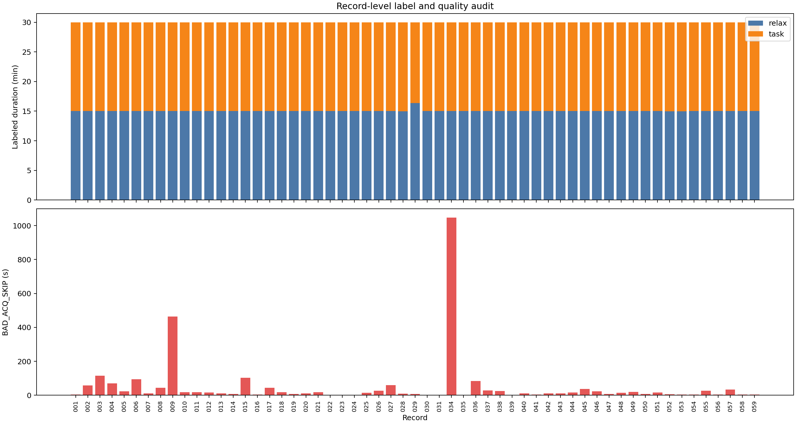
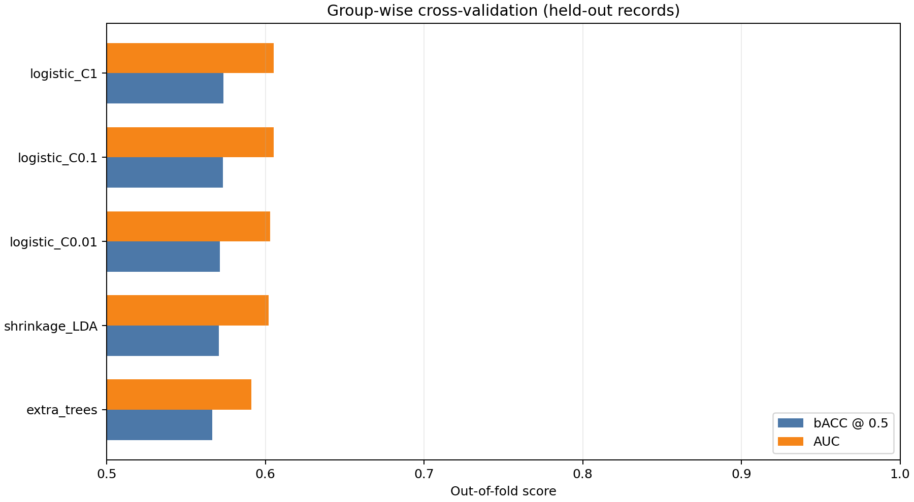
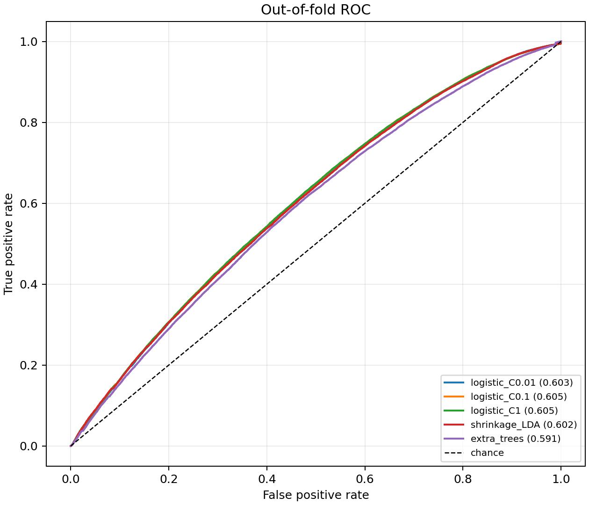
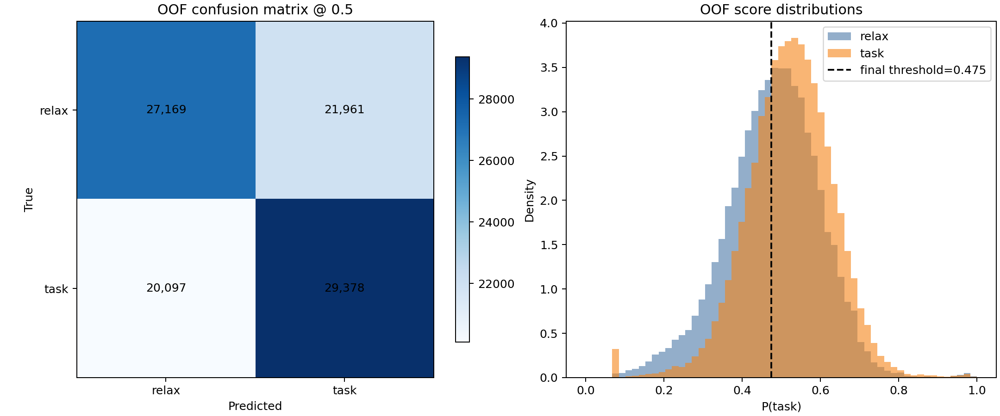
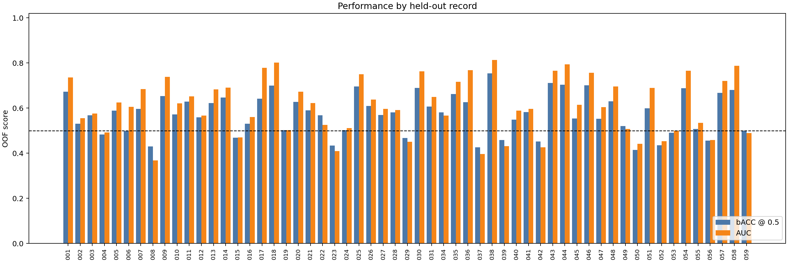
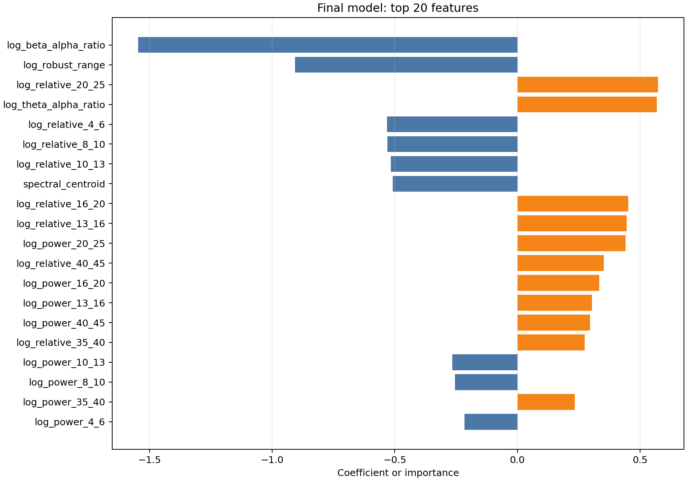
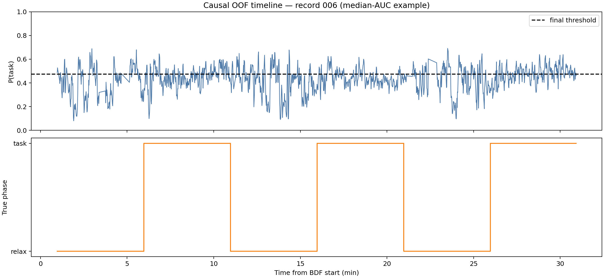

# 工业场景 EEG 认知状态解码实验报告

## 1. 实验概况

本实验使用 57 条真实记录，按**整条记录留出**进行 6 折分组交叉验证。所有验证窗口均来自训练阶段未见过的记录，避免相邻高相关窗口泄漏。共得到 98,605 个有效带标签判断窗口，其中 97,391 个窗口内部标签完全一致，仅后者用于拟合分类器；全部有效窗口用于验证，包括状态切换附近。

最终内部选择结果为 **logistic_C1**。OOF bACC（固定 0.5 阈值）为 **0.5734**，OOF AUC 为 **0.6053**。最终部署阈值 0.474840 由全部 OOF 预测选择，对应调阈值 OOF bACC 为 0.5755；该调阈值指标与阈值选择使用同一批 OOF 预测，不能视为独立测试成绩。

## 2. 数据审计

- 标签时长中位数：relax 15.00 min，task 15.00 min。
- 含 BAD_ACQ_SKIP 的记录数：56；坏段总时长 2754.97 s。
- 记录总时长范围：30.83–32.00 min。
- 详细逐记录结果见 `test/results/record_summary.csv`。



## 3. 合规因果流程

1. 从 BDF 文件名解析毫秒级开始时间，以实际事件时间配对 trial 并生成样本标签。
2. 将 BAD_ACQ_SKIP 掩码传递到窗口级质量判断，含坏段的窗口不参与训练或指标计算。
3. 每个判断仅使用过去 4 秒（1000 点），每 1 秒判断一次。
4. 当前窗口去均值后计算 2 秒 Welch 频谱、13 个细分频带的绝对/相对对数功率，以及 Hjorth、过零率、频谱熵等 11 个补充特征，共 37 维。
5. 训练时排除跨标签窗口；推理时按真实时间顺序输出，不借用未来标签或未来样本。
6. 流式类只保留 4 秒 deque 历史，不使用全记录标准化、双向滤波或未来平滑。

分数定义为 `P(task)`，越大越倾向认知负荷态；无效窗口输出 `valid=false` 和中性分数 0.5。

## 4. 模型对比

内部选择分为 `0.5 × (OOF bACC + OOF AUC)`，只用于在候选模型间排序，不代表主办方未公开的综合分公式。bACC 均在固定 0.5 阈值下计算，以便公平比较。

| 模型 | OOF bACC | OOF AUC | 折 bACC 均值 ± 标准差 | 选择分 |
|---|---:|---:|---:|---:|
| logistic_C1 | 0.5734 | 0.6053 | 0.5744 ± 0.0304 | 0.5894 |
| logistic_C0.1 | 0.5731 | 0.6052 | 0.5741 ± 0.0300 | 0.5892 |
| logistic_C0.01 | 0.5712 | 0.6031 | 0.5722 ± 0.0281 | 0.5872 |
| shrinkage_LDA | 0.5705 | 0.6021 | 0.5715 ± 0.0279 | 0.5863 |
| extra_trees | 0.5665 | 0.5911 | 0.5675 ± 0.0232 | 0.5788 |





## 5. 最终模型诊断







下图为记录级 AUC 接近中位数的记录 006，不是挑选的最佳示例。概率来自该记录完全留出时的因果预测。



## 6. 结果解释与限制

- 交叉验证估计的是对保留记录内新记录的泛化，不等同于决赛新被试、新设备状态或新测试集成绩。
- 多模型对比和最终阈值均使用同一数据集的 OOF 预测，仍存在选择偏差；最终模型需以主办方保留测试集验证。
- 窗口跨状态边界时，历史 EEG 与末端标签可能暂时不一致，这是严格因果任务的真实难度，未通过未来信息修正。
- 当前没有可靠证据把编号记录映射到具体被试，因此按记录分组；若确认同一被试有多条记录，应改为按被试分组重新验证。
- 概率分布可能在不同被试间漂移，AUC 与 bACC 应同时关注，不能仅报告总体准确率。

## 7. 复现入口

```powershell
python -m pip install -r requirements.txt
python src/train.py --data EEG_dataset --output test/results --model-out src/model.joblib
python src/infer.py --model src/model.joblib --input EEG_dataset/001/001_20261017_170137.984_UTC+0800.bdf --output test/results/001_predictions.csv --chunk-size 250
python -m pytest test -q
```

模型文件为 `src/model.joblib`，包含预处理和分类器、阈值、窗口配置、特征定义版本、训练记录清单及环境版本。推理代码和训练代码共用 `extract_features`，避免离线与部署特征不一致。
