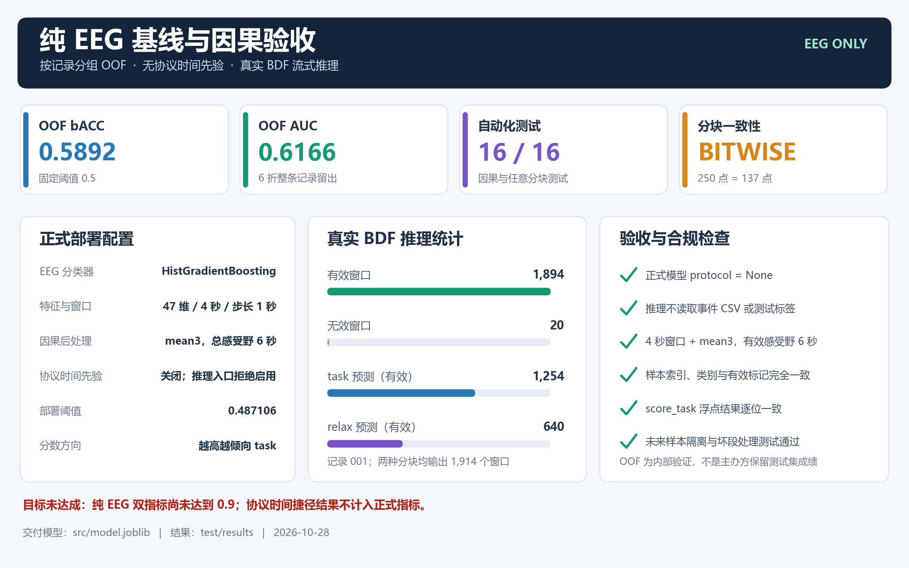
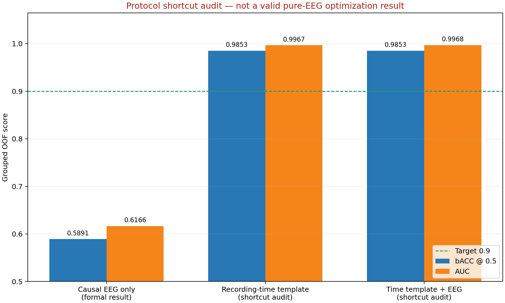

# 工业场景 EEG 认知状态解码运行说明

## 1. 交付文件

- `src/eeg_decoder.py`：BDF 读取、事件对齐、坏段掩码、因果特征与流式解码器。
- `src/train.py`：数据审计、按记录分组交叉验证、模型选择、最终训练与图表生成。
- `src/infer.py`：独立 BDF 推理入口。
- `src/model.joblib`：最终模型、阈值及完整推理配置。
- `requirements.txt`：固定依赖版本。
- `test/test_pipeline.py`：因果性与一致性测试。
- `实验报告.md`：实验方法、真实指标、可视化与限制。

推理不需要事件 CSV，也不需要训练数据。`score_task` 越大越倾向 `task`（认知负荷态），越小越倾向 `relax`（静息态）。

## 2. 运行环境

本次实际验证环境：

| 项目 | 配置 |
|---|---|
| 操作系统 | Microsoft Windows 10 Home 10.0.19045，AMD64 |
| CPU | Intel Core i5-1035G1 |
| 内存 | 7.6 GB |
| GPU | 不使用，纯 CPU 推理 |
| Python | 3.13.12 |
| numpy / scipy | 2.4.4 / 1.17.1 |
| pandas / matplotlib | 3.0.5 / 3.10.9 |
| scikit-learn / MNE | 1.9.1 / 1.13.2 |
| joblib / pytest | 1.5.3 / 9.1.1 |

`joblib` 模型对 Python 和 scikit-learn 版本敏感，请使用 `requirements.txt` 中的版本重建环境。

## 3. 环境配置

在项目根目录执行：

```powershell
python -m pip install -r requirements.txt
python -c "import numpy, scipy, sklearn, mne, joblib; print('dependencies OK')"
```

全部命令均在 PowerShell 中运行，不需要 MATLAB、CUDA 或 GPU 驱动。

## 4. 最小推理示例

```powershell
python src/infer.py --model src/model.joblib --input EEG_dataset/001/001_20261017_170137.984_UTC+0800.bdf --output test/results/001_predictions.csv --chunk-size 250
```

本次实际成功运行摘要：

```json
{
  "chunk_size": 250,
  "windows": 1914,
  "valid_windows": 1894,
  "task_windows": 1274,
  "threshold": 0.4871062917541215,
  "window_s": 4.0,
  "feature_mode": "raw",
  "postprocess": "mean3",
  "protocol_prior": false,
  "protocol_weight": null,
  "score_direction": "higher means task"
}
```

下图由上述实际运行摘要、分块一致性结果和 pytest 输出生成：



程序会生成：

- `test/results/001_predictions.csv`：逐窗口类别和连续分数；
- `test/results/001_predictions.summary.json`：实际运行参数与窗口统计。

输出 CSV 使用 UTF-8-SIG 编码，字段如下：

| 字段 | 含义 |
|---|---|
| `sample_index` | 判断窗口末端样本索引，从 0 开始 |
| `time_s` | 相对 BDF 第一个样本的秒数 |
| `score_task` | task 连续分数，数值越大越倾向 task |
| `prediction` | `task` 或 `relax` |
| `valid` | 当前窗口是否完全有效；含坏段时为 `False` |

含坏段的窗口返回中性分数 0.5 和 `valid=False`，不参与离线指标计算。程序对整条 BDF 按时间顺序推理，包括实验前后的无标签区间；评价时只使用实际 trial 内的有效标签区间。

## 5. 任意分块流式接口

`CausalStreamDecoder.push()` 可接收任意长度的一维 EEG 块，单位为 **µV**。`valid` 是与数据等长的布尔数组，`False` 表示坏样本；省略时仅自动检查非有限值。

```python
import joblib
from eeg_decoder import CausalStreamDecoder, DecoderConfig

artifact = joblib.load("src/model.joblib")
decoder = CausalStreamDecoder(
    model=artifact["model"],
    threshold=artifact["threshold"],
    config=DecoderConfig.from_dict(artifact["config"]),
    feature_mode=artifact["feature_mode"],
    baseline_s=artifact["baseline_s"],
    postprocess=artifact["postprocess"],
)

for samples_uv, valid in incoming_blocks:
    for result in decoder.push(samples_uv, valid):
        print(result)
```

默认每 250 个采样点（1 秒）产生一次结果。积累到完整窗口前返回空列表，这是正常行为。BDF 读取器已将 MNE 的伏特值转换为微伏；直接调用流式接口时也必须提供微伏值。

## 6. 最终算法与合规约束

- 每个判断使用当前及过去 **4 秒** EEG，共 1000 点。
- 使用 2 秒 Welch 分段、18 个频带的绝对/相对对数功率及 11 个时域/频谱特征，共 47 维；不为 48–52 Hz 工频区间构造频带特征。
- `mean3` 只平均当前和前两次有效分数，总有效感受野为 **4 + 2 × 1 = 6 秒**。
- 遇到坏段或时间间隙立即清空分数历史，不跨无效区间平滑。
- 不使用双向滤波、未来样本、全记录标准化、测试标签或人工干预。
- 最终配置为 `feature_mode=raw`，不使用基线自适应或任何测试记录统计量。
- 正式模型不启用协议时间先验，不根据录制时刻推断阶段；评分只由因果 EEG 特征及因果后处理产生。
- `src/infer.py` 会拒绝包含协议模板的模型文件，防止误将捷径实验模型用于正式提交。
- 协议模板实验仅用于审计固定流程捷径，不计入正式优化指标；若需复现该风险对照，必须显式传入 `--protocol-prior`。
- 模型加载时校验格式版本、特征版本、输入维度、输入单位和 BDF 采样率。

## 7. 完整重训与结果复现

```powershell
python src/train.py --data EEG_dataset --output test/results --model-out src/model.joblib --report-out 实验报告.md --window-s 4 --feature-mode raw --postprocess mean3 --no-protocol-prior
```

训练按整条记录进行 6 折分组交叉验证。标准化器仅在各折训练记录上拟合；跨标签窗口不参与模型拟合，但保留在验证中。缓存键绑定数据目录、文件大小和修改时间、特征版本以及特征源码哈希。更换数据或特征代码后会自动重建，也可用 `--rebuild` 强制重建。

主要输出：

- `test/results/model_comparison.csv` 和 `model_comparison.png`；
- `test/results/fold_metrics.csv` 和 `record_metrics.csv`；
- `test/results/roc_curves.png`；
- `test/results/best_score_diagnostics.png`；
- `test/results/record_performance.png`；
- `test/results/feature_importance.png`；
- `test/results/example_timeline.png`；
- `test/results/oof_predictions.csv`。

## 8. 自动化验证

```powershell
python -m pytest test/test_pipeline.py -q
```

测试覆盖：毫秒级事件对齐、trial 配对、6 秒限制、特征有限性、任意分块一致性、坏段处理、未来样本隔离、无标签上下文平滑、协议融合及验证折事件隔离、基线模式、缓存指纹和分组折隔离。

真实分块复核命令：

```powershell
python src/infer.py --model src/model.joblib --input EEG_dataset/001/001_20261017_170137.984_UTC+0800.bdf --output test/results/001_predictions_chunk137.csv --chunk-size 137
```

应与 250 点分块产生相同的逐窗口分数和索引。本次真实 BDF 验收已通过：两种分块均输出 1,914 个窗口，`sample_index`、`score_task`、`prediction` 和 `valid` 全部逐位一致，见 `test/results/chunk_consistency.json`。自动化测试实际结果为 **16 passed**，见 `test/results/pytest_output.txt`。

## 9. 可视化结果




## 10. 使用限制

报告指标是训练数据上的分组 OOF 估计，不是主办方保留测试集成绩。模型选择及最终阈值使用同一数据集的 OOF 预测，存在一定选择偏差。正式纯 EEG 模型目前只有约 0.59 bACC 和 0.62 AUC，尚未达到双指标 0.9。协议时间模板的高分主要来自固定实验流程，存在任务捷径和合规风险，已不再作为正式结果，不能解释为纯生理解码能力。
